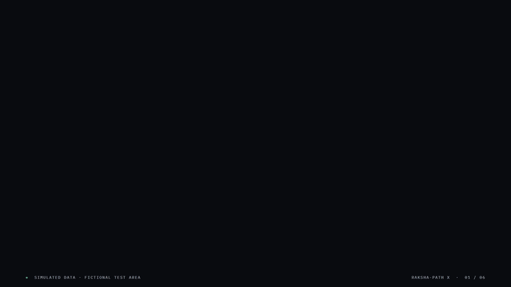
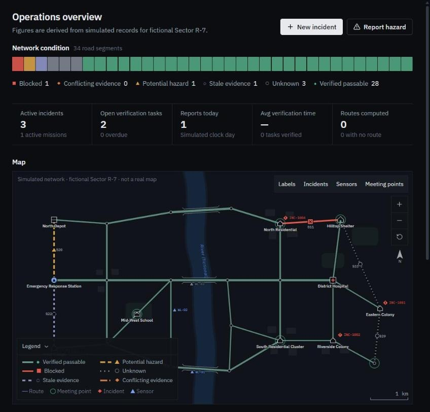
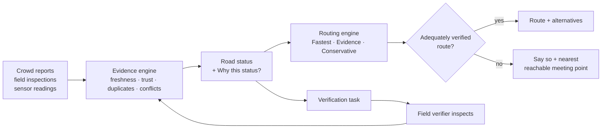
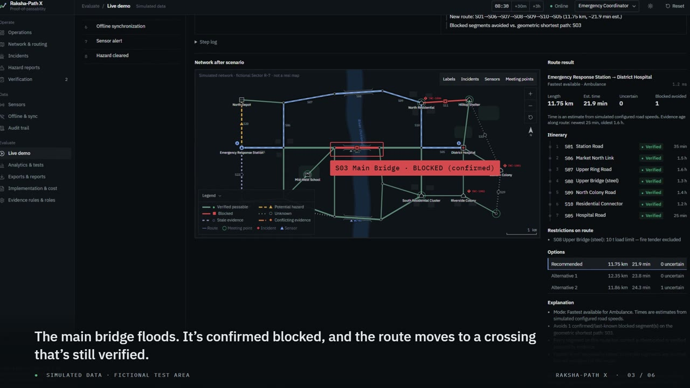
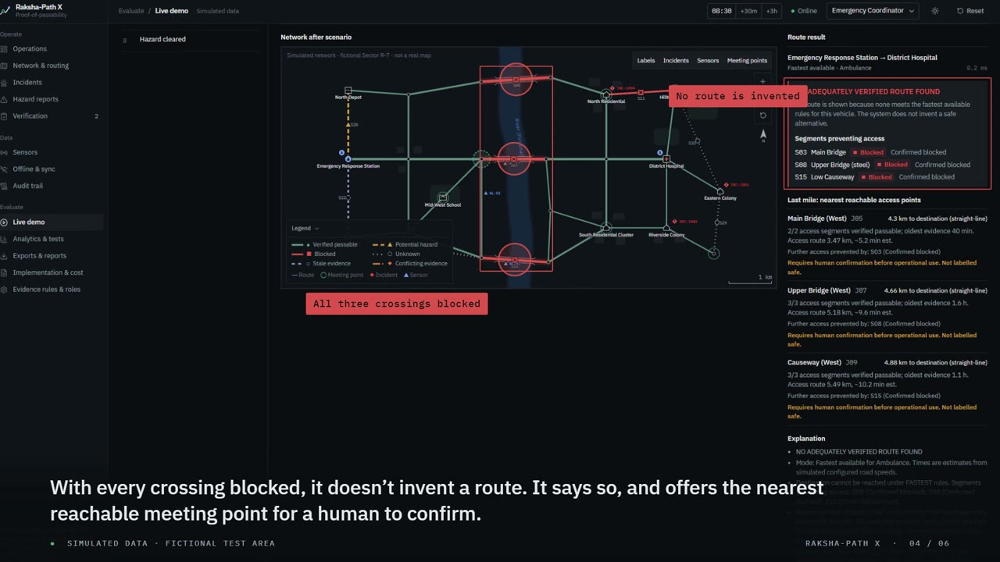
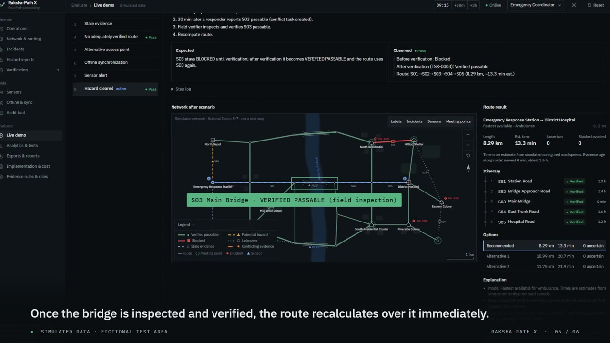

<div align="center">

# RAKSHA-PATH X

### Proof-of-Passability Emergency Intelligence Network

**Every route needs evidence. Every rescue needs a safer path.**

     

SEVA First Innovation Challenge 2026 · Theme 5: **Surakshit Bharat** · Team **RAKSHA-PATHX-100**

</div>

---

## ▶ Demo video (45 s)

[](docs/media/raksha-path-x-demo.mp4)

**[▶ Watch the full-quality MP4](docs/media/raksha-path-x-demo.mp4)** (1920×1080, 45 s, no audio; captions carry the story)

> All data shown is **simulated**. "Sector R-7" is a fictional test area. No real road conditions are shown, no emergency service is dispatched, and trained responders remain responsible for every operational decision.

---

## Contents

- [The problem](#the-problem)
- [The idea: Proof-of-Passability](#the-idea-proof-of-passability)
- [What it does](#what-it-does)
- [How it decides](#how-it-decides)
- [Measured results](#measured-results)
- [Live demo scenarios](#live-demo-scenarios)
- [Quick start](#quick-start)
- [Architecture](#architecture)
- [Tech stack](#tech-stack)
- [Testing](#testing)
- [Responsible design and limitations](#responsible-design-and-limitations)
- [Roadmap and pilot plan](#roadmap-and-pilot-plan)
- [Project documents](#project-documents)

---

## The problem

When a flood or landslide hits, the question for an ambulance or rescue crew is not *"what is the shortest route?"* but:

> **Which roads do we have recent, credible evidence are actually passable, and what do we do when we don't?**

Consumer navigation optimises travel time from traffic data. It does not certify that a road is physically passable. In a disaster that gap costs rescue time: crews drive toward a flooded bridge, a collapsed road or a fallen tree, then turn back.

Disaster information has its own problems. It is crowd-sourced, unverified, contradictory and quickly out of date, and connectivity often fails just when it is needed.

## The idea: Proof-of-Passability

RAKSHA-PATH X treats **every road as unproven until evidence says otherwise**.

- Each road segment carries a status **derived from its evidence**: how recent it is, who reported it, and whether it was independently verified.
- **No report means Unknown, never open.**
- A **confirmed block is never routed through**. It is lifted only by a verified inspection.
- **Contradicting reports are both kept.** Neither is trusted automatically; a field verifier is tasked.
- When no adequately verified route exists, the system **says so** and proposes the **nearest reachable meeting point** for a human to confirm, instead of inventing a route.

Every status has a **"Why this status?"** trail: no black-box AI score.

<p align="center"></p>

## What it does

| Module | What it does |
|---|---|
| **Operations dashboard** | Network-condition bar (one cell per road), key figures, roads needing attention, incidents, activity feed. Every number is derived from stored records |
| **Network & routing** | Interactive map (pan, zoom, layers, legend, scale bar); route planner with 3 modes and alternatives; per-road evidence detail |
| **Proof-of-Passability engine** | Freshness by hazard type, source trust tiers, duplicate detection, conflict detection, vehicle restrictions, explanations |
| **Hazard reporting** | Validated form (category, road, condition, time, severity, source, vehicle access, water level, image, opt-in contact); duplicate guard; legacy road-ID mapping |
| **Incident management** | Create and edit incidents, assign simulated units, status workflow from Received to Closed, route per incident, timeline, closure verification |
| **Verification tasks** | Auto-created for conflicts, unverified hazards, stale roads and sensor alerts; assign, inspect, verify, reject, escalate. Results re-route immediately |
| **Last-mile reachability** | Ranks reachable meeting points by distance and evidence when the destination is cut off |
| **Offline mode** | Queues reports while offline, syncs with conflict detection, shows last-sync time; service-worker app cache |
| **Sensors (optional)** | Simulated water-level gauges and an ESP32-ready adapter; thresholds, out-of-range and disconnect detection; alerts open verification tasks |
| **Audit trail** | Append-only event log with provenance |
| **Analytics & evaluation** | Charts from stored data, 27-case evaluation against a shortest-path baseline, CSV export |
| **Live demo** | 8 one-click scenarios that change real application state, with expected vs observed results and pass/fail |
| **Roles** | Coordinator, Field Verifier, Local Authority, Read-Only Observer. Visibly changes available actions; the observer role hides incident details |
| **Exports** | CSV for incidents, reports, tasks, road history, evidence, routes, costs, audit, sensors; printable incident summary |

## How it decides

### Road statuses

| Status | Meaning |
|---|---|
| 🟢 **Verified passable** | Recent "passable" evidence from an authenticated or verified source |
| 🟡 **Potential hazard** | A hazard was reported but is not verified, or does not block the road |
| 🔴 **Blocked** | Confirmed by an authenticated or verified source. Never used for routing |
| ⚪ **Unknown** | No adequate evidence. Absence of reports is not treated as passable |
| 🟣 **Stale evidence** | Evidence is older than its hazard-specific limit; re-inspection needed |
| 🟠 **Conflicting evidence** | Recent reports disagree; both are kept and a verifier is tasked |

In the app every status also has its own glyph and text label, so colour is never the only signal.

### Evidence rules

- **Trust tiers:** verified (3) > authenticated responder / authority / verifier (2) > identified public or sensor (1) > anonymous (0).
- **Freshness limits are set per hazard type** and configurable in the app. For example, a flood report expires after 2 h and a fallen tree after 12 h. "Passable" evidence expires after 12 h, or after 4 h on flood-prone roads.
- A **verified observation supersedes older evidence**. Anything newer than it is still considered.
- A **sensor reading never makes a road passable**. Water-level readings above threshold raise a hazard and open a verification task.
- **Duplicates** (same source and claim within 30 min) count once.
- **Confidence** is qualitative (High / Medium / Low) and comes from trust tier and evidence age.

### Routing modes

| Mode | Behaviour |
|---|---|
| **Fastest available** | Minimises estimated time. Excludes blocked, last-known-blocked and vehicle-incompatible roads; uncertain roads are counted but not penalised |
| **Evidence-prioritised** | Same exclusions, plus configurable cost penalties for stale, unknown, hazard and conflicting roads |
| **Conservative emergency** | Uses only verified-passable roads. Otherwise reports **NO ADEQUATELY VERIFIED ROUTE FOUND**, lists the blocking roads and ranks reachable meeting points |

Routing uses Dijkstra's algorithm on the road graph, with alternatives found by removing one edge of the best path at a time. Times are **estimates** from simulated road speeds. The fastest route is not necessarily the safest.



## Measured results

From the built-in evaluation suite (`npm test`, or **Analytics → Run evaluation** in the app), compared against a plain shortest-path baseline that ignores evidence:

| Measure | Shortest-path baseline | RAKSHA-PATH X |
|---|---|---|
| Confirmed-blocked road segments routed through (11 routing cases) | **4** | **0** |
| Unverified segments on chosen routes (11 routing cases) | **7** | **0** |
| Evaluation cases passing | — | **27 / 27** |
| End-to-end demo scenarios passing | — | **8 / 8** |
| Automated tests | — | **34 / 34** |

> These are **simulated test results on a fictional network**, not field validation.

## Live demo scenarios

Open **Live demo** in the app and press **Start scenario**. Each one resets to the seeded data and applies real actions, so every other page reflects the result.

| # | Scenario | What you see |
|---|---|---|
| 1 | Flood blocks the fastest route | Main Bridge confirmed blocked; the route moves to another verified crossing |
| 2 | Conflicting reports | Responder says passable, anonymous report says blocked; status is Conflicting and a task is created |
| 3 | Stale evidence | Clock advances 6 h; flood-prone roads go stale and routes change |
| 4 | No adequately verified route | All three river crossings blocked; the fail-safe message and a meeting point appear |
| 5 | Alternative access point | Colony access road blocked; South Gate meeting point offered with remaining distance |
| 6 | Offline synchronisation | Report queued offline; on reconnect it syncs and the conflict is detected |
| 7 | Sensor alert | Rising simulated water level; potential hazard plus a verification task |
| 8 | Hazard cleared | Field verification reopens the bridge; routes recalculate over it |

<p align="center">
  
  
  
</p>

## Quick start

### One click (Windows, no Node.js needed)

Double-click **`RAKSHA-PATH X.exe`** in the project folder. It serves the prebuilt app from `dist/` at `http://localhost:4173` (or the next free port) and opens your browser. Close the console window to stop.

### From source

```bash
git clone https://github.com/Abishekh2007/sewa-.git
cd sewa-
npm install
npm run dev        # http://localhost:5173
```

| Command | Purpose |
|---|---|
| `npm run dev` | Development server |
| `npm test` | Engine unit tests + full evaluation suite (vitest) |
| `npm run typecheck` | TypeScript check |
| `npm run build` | Production build into `dist/` (keep it current; the exe serves it) |
| `npm run preview` | Serve the build; the service worker enables offline reload |

No API keys, accounts or paid services. Data persists in the browser (`localStorage`). Use **Reset** in the top bar to restore the seed data.

**Offline test:** run `npm run build && npm run preview`, load the app once, set DevTools → Network → *Offline*, then reload.

## Architecture

```
src/
  types.ts              data model (RoadSegment, EvidenceRecord, HazardReport, RouteResult, VerificationTask, ...)
  data/seed.ts          fictional network: 22 junctions, 34 road segments, seed evidence, incidents, sensors, costs
  engine/
    evidence.ts         Proof-of-Passability assessment (pure functions)
    routing.ts          Dijkstra routing, 3 modes, alternatives, last-mile, baseline
    actions.ts          every state change as (state) => state; reconcile() logs status changes and opens tasks
    scenarios.ts        8 live-demo scenarios built from real actions
    testcases.ts        27 deterministic evaluation cases vs baseline
    engine.test.ts      vitest suite
  state/store.tsx       React store, localStorage persistence, hash router
  ui/                   design system (kit.tsx), SVG network map, route view, segment detail
  pages/                one file per module
  utils/csv.ts          RFC 4180 CSV export
launcher/               C# source for the one-click Windows launcher
presentation/           challenge submission deck (PPTX + PDF)
docs/                   design rules, handoffs, media
```

The evidence and routing engines have **no UI dependencies** and are tested on their own. The UI only applies pure actions: `update(s => action(s, ...))`.

## Tech stack

| Layer | Choice |
|---|---|
| Frontend | React 18, TypeScript, Vite, Tailwind CSS v4, Lucide icons, IBM Plex fonts (bundled) |
| Map | Custom SVG renderer for the fictional network (no map tiles or keys) |
| Routing | Dijkstra graph engine in TypeScript |
| Charts | Recharts |
| Storage & offline | LocalStorage, Service Worker |
| Tests | Vitest + jsdom |
| Launcher | C# (.NET Framework, built into Windows) |
| Optional hardware | ESP32 + water-level sensor posting `{ "sensorId": "WL-01", "valueCm": 42, "ts": 1760000000000 }` |

## Testing

```bash
npm test
```

34 tests: 27 deterministic evaluation cases plus 7 unit tests. They cover blocked-road exclusion, vehicle restrictions, stale and conflicting evidence, recalculation after verification, no-route behaviour, alternative routes, offline sync, sensor thresholds, persistence, CSV export and scenario reset determinism.

<details>
<summary><b>Challenge acceptance tests: where each one is demonstrated</b></summary>

| Test | Evidence |
|---|---|
| A: normal route | T01, Network & routing page |
| B: blocked road avoided | T02, Scenario 1 |
| C: no adequately verified route | T11, Scenario 4 |
| D: conflict creates a task | T04, Scenario 2 |
| E: stale evidence | T05/T06, Scenario 3 |
| F: verification changes routing | T15, Scenario 8 |
| G: offline queue + sync | T12, Scenario 6, Offline page |
| H: sensor alert + task | T13, Scenario 7, Sensors page |
| I: persistence after reload | T26 + localStorage unit test |
| J: analytics from real records | Analytics page (derived from stored state) |
| K: CSV export | T25 + Exports page |
| L: no paid API keys | No external services used |
| M: built-in dataset only | All scenarios run from the seed |
| N: simulated vs field data | "Simulated data" notices, SIMULATED tags, CSV header line |

</details>

## Responsible design and limitations

**By design**
- Decision support only. It never auto-dispatches, never labels a route "safe", and requires human confirmation for meeting points.
- Minimal data: contact details only with explicit consent. The observer role cannot see incident locations or notes.
- Uploaded images are type- and size-checked, and are never treated as proof of location or time.
- Keyboard navigation, visible focus, screen-reader labels, and status shown by glyph + text + colour. Light and dark themes.

**Current limitations**
- Fictional network and simulated data only; nothing is field-validated yet.
- Freshness limits and penalties are starting assumptions that need calibration with responders.
- Client-side roles are **not** security; a real deployment needs server-side authorisation.
- LocalStorage and the audit log are not tamper-proof.
- Alternatives use first-order edge removal, not full k-shortest-paths.
- The ESP32 adapter is an interface only, fed by a simulated sensor.

## Roadmap and pilot plan

1. **Software simulation**: this prototype ✅
2. **Controlled routing tests**: tabletop exercises with responders
3. **Stakeholder feedback**: ward office, ambulance and fire services
4. **Optional hardware demo**: ESP32 water-level gauge at a non-public test site
5. **Limited pilot**: with real road data (local GIS / OpenStreetMap), subject to permissions, data-protection review and validation

Estimated costs: software ₹0 (open-source, free-tier hosting); an optional sensor node costs about ₹2,600 (indicative, requires supplier verification). See **Implementation & cost** in the app.

## Project documents

| Document | Purpose |
|---|---|
| [`presentation/`](presentation/) | Challenge submission deck (PPTX + PDF) |
| [`HANDOFF.md`](HANDOFF.md) | Project status, rules not to break, next steps |
| [`docs/DESIGN.md`](docs/DESIGN.md) | UI design system rules |
| [`docs/VIDEO_HANDOFF.md`](docs/VIDEO_HANDOFF.md) | Brief and shot list used to make the demo video |

## References

1. NDMA, *National Disaster Management Plan* (2019). <https://ndma.gov.in>
2. NDMA, *Guidelines on Management of Urban Flooding* (2010). <https://ndma.gov.in>
3. UNDRR, *Sendai Framework for Disaster Risk Reduction 2015–2030*. <https://www.undrr.org>
4. Central Water Commission, flood forecasting services. <https://cwc.gov.in>
5. Dijkstra, E. W. (1959). A note on two problems in connexion with graphs. *Numerische Mathematik*, 1, 269–271.
6. Humanitarian OpenStreetMap Team. <https://www.hotosm.org>

---

<div align="center">
<sub>Team RAKSHA-PATHX-100 · SEVA First Innovation Challenge 2026 · Simulated prototype: decision support for trained responders</sub>
</div>
